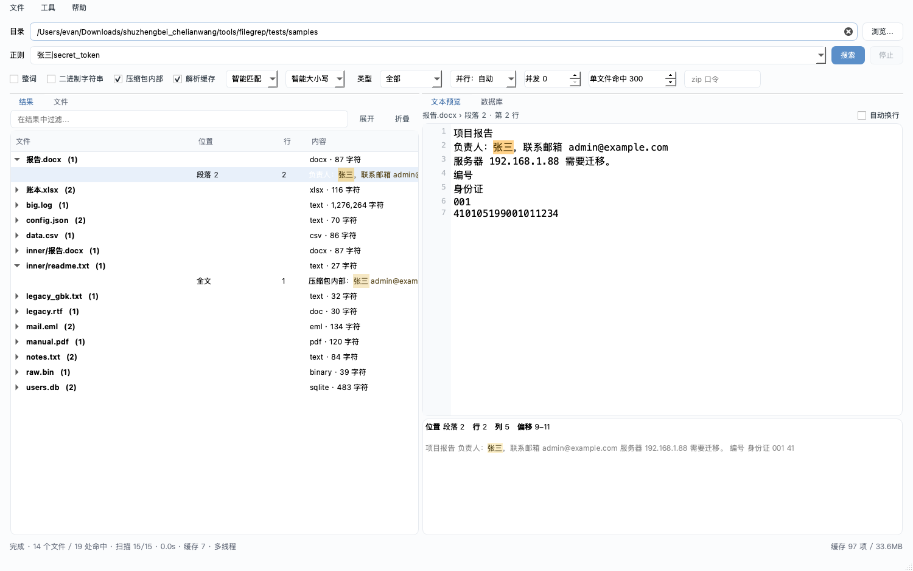
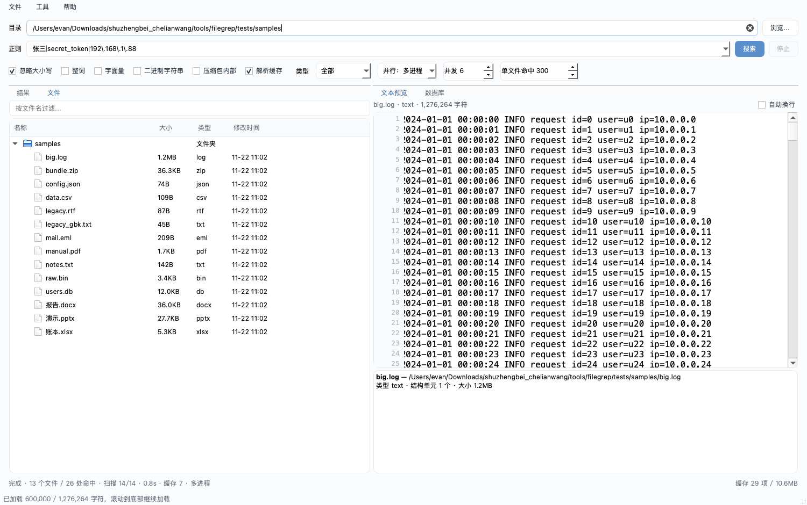

# FileGrep · 全格式文件内容检索器

把一个文件夹里**所有文件的内容**抽成文本，用**正则**搜索，命中直接定位到
「第几页 / 哪个工作表第几行第几列 / 哪张数据库表第几行 / 压缩包里哪个成员」，
在界面里高亮标出，并可一键在 Finder 中定位。

支持 Office、PDF、SQLite/Access、压缩包、邮件、电子书、源码与任意二进制。
解析层基于成熟开源库，界面基于 PySide6，浅色清爽风格，无 emoji。



---

## 为什么不是 grep

`grep` 只能看纯文本。真实场景里要查的东西往往在 `.docx` 的表格里、`.xlsx` 的某个
单元格里、PDF 的第 7 页里、SQLite 某张表的某一行里，或者压在 `.zip` 里的车机日志里。
FileGrep 把这些格式统一抽成带**结构定位信息**的文本，再跑正则，所以每条命中都能告诉你
「在哪一页、哪一行、哪个单元格」。

---

## 快速开始

```bash
git clone https://github.com/EvanYzl/filegrep.git
cd filegrep

# macOS 双击启动（首次会自动建 venv 并装依赖）
./run.command

# 或者手动
python3 -m venv --system-site-packages .venv
.venv/bin/pip install -r requirements.txt
.venv/bin/python -m filegrep --gui

# 或当作命令行工具
.venv/bin/python -m filegrep "张三|138\d{8}" ~/Downloads
```

也可以 `pip install -e .` 之后直接用 `filegrep`（命令行）和 `filegrep-gui`（界面）。

---

## 界面



| 面板 | 能力 |
|---|---|
| 结果 | 文件 → 命中两级树，内容列直接着色命中文字，双击跳到位置 |
| 文件 | 目录树懒加载，点任意文件即在右侧预览，**所有格式都能看** |
| 文本预览 | 行号栏 + 等宽字体；全部命中淡黄、当前命中琥珀色并自动居中；超大文件分块加载 |
| 数据库 | 选中 `.db` 自动打开；选表、写 SQL、看结果、查结构、导出 CSV（只读，写操作被拦） |
| 跳转到数据库行 | **双击**左侧来自数据库的命中，自动切到数据库页、选中对应表、定位到那一行（上下各 8 行上下文） |

命中位置标注示例：

```
工作表 人员 · 第 2 行 · B2         ← Excel 单元格
第 7 页                            ← PDF
表 users · 第 1 行                  ← SQLite
表格1 R1C2                         ← Word 表格
原始字符串 · 0x00000bb9             ← 二进制文件偏移
logs/aplog · 第 9742 行             ← 压缩包成员
```

数据库命中支持「双击直达」：命中元数据里记录了 `rowid`，双击时执行
`SELECT rowid, * FROM 表 WHERE rowid BETWEEN ? AND ?`，把目标行选中并居中；
没有 `rowid` 的表/视图自动退回按行号 `LIMIT 1 OFFSET n-1` 的方式定位。

### 文件内继续查找

点开一个文件后，预览上方有一条「在当前文件里继续查找」：

* 输入关键词按 `回车` 叠加一个条件，多个**包含**条件之间是 AND（同一行内同时出现）
* 条件可以是**排除**：把左侧下拉切到「排除」，或在输入开头写 `-` / `!`
  （如 `-error`、`!debug`），该行只要命中排除词就被剔除
* 条件以标签列出，包含为蓝色 `request ×`，排除为红色 `− user=u7 ×`，点 `×` 单独移除
* **选中预览里的文字 → 右键**，可以直接「用…继续筛选（包含）」或「排除含…的行」
* 命中行整体着色、关键词描亮，当前行高亮并自动居中；`上一处 / 下一处` 在结果间跳
* 顶部实时显示「N 行匹配 · 第 i/N」
* 对 5MB / 4 万行的日志，加一个条件约 50ms

```
big.log · 文件内筛选：request；排除 user=u7
19600 行匹配 · 第 1/19600
```

左侧结果列表顶部的过滤框也支持同样语法：空格分隔多个词即 AND，`-词` 或 `!词` 表示排除。

```
张三 -李四        # 命中里含「张三」但不含「李四」的
```

### 快捷键

| 快捷键 | 功能 |
|---|---|
| `⌘F` / `Ctrl+F` | 聚焦正则输入框 |
| `⌘L` / `Ctrl+L` | 聚焦目录输入框 |
| `Enter`（正则框内） | 开始搜索 |
| `F3` / `⇧F3` | 下一个 / 上一个命中 |
| `⌘⇧R` | 在 Finder 中定位当前文件 |
| `⌘O` | 用系统默认程序打开当前文件 |
| `⌘1` / `⌘2` | 切换「结果 / 文件」 |
| `⌘3` / `⌘4` | 切换「文本预览 / 数据库」 |
| `⌘Enter`（SQL 框内） | 执行 SQL |
| `Esc` | 停止搜索 |

---

## 支持的格式

| 类别 | 格式 | 定位粒度 |
|---|---|---|
| Word | `.docx` `.docm` `.dotx` `.doc` `.rtf` | 段落序号 / 表格 R*C |
| Excel | `.xlsx` `.xlsm` `.xls` `.csv` `.tsv` | 工作表 + 行 + **单元格地址** |
| PowerPoint | `.pptx` `.pptm` `.ppt` | 幻灯片序号 / 备注 |
| PDF | `.pdf` | **页码** |
| 数据库 | `.db` `.sqlite` `.sqlite3` `.db3` `.mdb` `.accdb` | 表名 + 行号 + 列值 |
| 压缩包 | `.zip` `.7z` `.rar` `.tar` | 成员路径（成员级并行） |
| 邮件 | `.eml` `.msg` `.mbox` | 邮件头 / 正文 / 附件 |
| 电子书 | `.epub` `.odt` `.ods` `.odp` | 章节 / 段落 |
| 文本 / 代码 | `.txt` `.log` `.md` `.json` `.xml` `.yaml` `.sql` `.py` … | 行号 + 列号 |
| 任意二进制 | 未知格式 | 原始字符串 + **文件偏移 0x…** |

编码自动识别：UTF-8 / UTF-16 / **GB18030（GBK/GB2312）** / Big5 / Shift-JIS / Latin-1。
加密 Office（空口令与常见弱口令）会自动尝试解密；加密 PDF 同样处理。
未知格式最后兜底走 [markitdown](https://github.com/microsoft/markitdown)。

---

## 压缩包

「压缩包内部」默认开启。zip 会被展开成**成员级任务**：每个成员单独解压、单独解析、
单独定位，并独立参与多进程并行——不会把几百 MB 日志拼成一个巨型字符串，也不会
因为一个坏成员中断整包。

* 成员采用**黑名单**策略：除图片/音视频/字体/可执行/压缩包外一律尝试解析，
  所以 `logs/aplog`、`aplog.01`、`aplog.14`、`kernel_kmsg.8` 这类没有常规扩展名的日志也能搜到
* 未知扩展名的普通文件同样会尝试解码，并用文本质量分过滤掉乱码二进制
* 加密成员会被**跳过并计数**，状态栏显示「N 个加密已跳过」，同时出现「重搜加密项」按钮
* 在顶部「zip 口令」里填入密码（多个用逗号分隔）后回车，即可把加密内容也纳入结果
* 口令只用于本次进程，不写入任何配置

```
扫描 88/88 个文件，命中 5 文件 / 66 处，44 个加密无法读取，用时 1.4s
```

---

## 大小写

三态，默认**智能**（与 ripgrep 一致）：

| 模式 | 行为 |
|---|---|
| 智能大小写 | 正则里出现大写字母就区分大小写，否则忽略 |
| 忽略大小写 | 始终忽略 |
| 区分大小写 | 始终区分 |

搜 VIN、哈希这类必须大写的编码时，智能模式能保证 `(?<![A-Z0-9])` 这类边界断言按预期工作。

---

## 命令行

```bash
python -m filegrep PATTERN PATH... [选项]

-i / -s            忽略 / 区分大小写
--case smart|ignore|sensitive   大小写模式（默认 smart）
-w                 整词匹配
-F                 按字面量（不当正则）
--type 全部|文档/Office|文本|数据库|压缩包|邮件|代码
--ext .txt,.docx,.db            自定义扩展名白名单
--exclude '**/cache/**'         排除（可多次）
--backend process|thread|auto   并行后端
--workers N        并发度（0=自动）
--zip-pass 口令     加密 zip 的口令，逗号分隔可给多个
--no-archives      不进入压缩包内部
--deep             对二进制做原始字符串扫描
--no-cache         关闭解析缓存
--json | --count | -l | --stats
--list-types       列出支持的所有扩展名
```

输出形如：

```
报告.docx:2:5: [段落 2] 负责人：张三，联系邮箱 admin@example.com
账本.xlsx:2:4: [工作表 人员 · 第 2 行] A2=张三 | B2=410105… | C2=…
users.db:7:17: [表 servers · 第 1 行] host=web01 | ip=192.168.1.88
manual.pdf:3:13: [第 1 页] IP address: 192.168.1.88
```

---

## 速度

三层设计：

1. **多进程并行**：解析是 CPU 密集型，进程池绕开 GIL。文件数 ≥ 64 时自动切多进程，
   进程数按 CPU 与文件规模自适应，可手动指定。
2. **解析缓存**：`~/Library/Caches/filegrep/docs.db`，键 = 路径 + mtime + 大小 + 解析器版本，
   文件一改自动失效。只给「解析昂贵」的格式（Office / PDF / 数据库 / 压缩包）做缓存——
   纯文本重解析比读缓存更快。
3. **按需加载**：命中只回传轻量结构，全文留在缓存里，双击预览时才按需读取；
   超大文档预览只渲染命中附近 30 万字符，行号栏仍显示全文真实行号。

参考数据：全工作区 3312 个文件、多进程 3.5 秒；2 个 27MB 的日志压缩包（内部 262MB）1.4 秒。

---

## 解析后端

| 用途 | 项目 |
|---|---|
| Word / Excel / PPT | [python-docx](https://github.com/python-openxml/python-docx) · [openpyxl](https://foss.heptapod.net/openpyxl/openpyxl) · [python-pptx](https://github.com/scanny/python-pptx) |
| PDF | [PyMuPDF](https://github.com/pymupdf/PyMuPDF) → pdfplumber → pypdf → poppler `pdftotext` |
| 老式 Office | macOS `textutil`、[xlrd](https://github.com/python-excel/xlrd) |
| Access | [mdbtools](https://github.com/mdbtools/mdbtools) |
| SQLite | Python 标准库 `sqlite3`（只读 URI） |
| 压缩包 | [py7zr](https://github.com/miurahr/py7zr) · [rarfile](https://github.com/markokr/rarfile) · `7zz` · 标准库 `zipfile` |
| Outlook 邮件 | [extract-msg](https://github.com/TeamMsgExtractor/msg-extractor) |
| 加密 Office | [msoffcrypto-tool](https://github.com/nolze/msoffcrypto-tool) |
| 万能兜底 | [markitdown](https://github.com/microsoft/markitdown) |
| 编码识别 | [charset-normalizer](https://github.com/Ousret/charset_normalizer) |
| 界面 | [PySide6](https://doc.qt.io/qtforpython/) |

所有依赖都做了**降级链路**：库装不上或解析失败时，回退到内置的 `zipfile + ElementTree`
实现，再回退到 markitdown，最后回退到原始字符串扫描——批量扫描不会因为一个坏文件中断。

---

## 目录结构

```
filegrep/
├── filegrep/
│   ├── model.py       数据结构：Document / Segment（定位单元）/ Hit
│   ├── extract.py     各格式抽取器（零依赖实现 + 编码探测 + 二进制字符串）
│   ├── parsers.py     成熟库优先实现（python-docx / openpyxl / PyMuPDF / 7z …）
│   ├── engine.py      文件枚举 + 多进程/多线程搜索引擎
│   ├── cache.py       SQLite 解析缓存（LRU + 容量上限）
│   ├── gui_qt.py      PySide6 界面（结果树 / 文件浏览 / 预览 / SQL 控制台）
│   ├── cli.py         命令行
│   └── __main__.py    python -m filegrep
├── tests/
│   ├── make_samples.py  生成 14 种格式的测试语料
│   └── test_core.py     回归测试（20 项）
├── docs/              截图
├── run.command        双击启动 GUI
└── filegrep.sh        命令行入口
```

---

## 测试

```bash
.venv/bin/python tests/test_core.py
```

覆盖：各格式抽取、定位元数据（页码/工作表/单元格/表行）、正则与整词与字面量与大小写、
扩展名过滤、命中上限、缓存失效、SQLite 只读保护、损坏文件不崩。

---

## 已知限制

* 扫描版 PDF（纯图片）没有文本层，需要额外 OCR，当前会提示「无可提取文本」。
* 老式 `.ppt` 只能做字符串扫描（另存为 `.pptx` 可获得完整结构定位）。
* Access / 7z / rar 依赖外部工具（mdbtools、7zz）；缺失时自动降级并给出提示。
* Excel 的公式单元格显示公式原文而非计算结果（openpyxl 不计算）。
* 加密 zip 成员需要口令；未提供时跳过并在状态栏计数，不会静默丢失。
* 预览定位按字符偏移；超过 30 万字符的文档只渲染命中附近片段（行号为全文行号）。

---

## License

[MIT](LICENSE)
